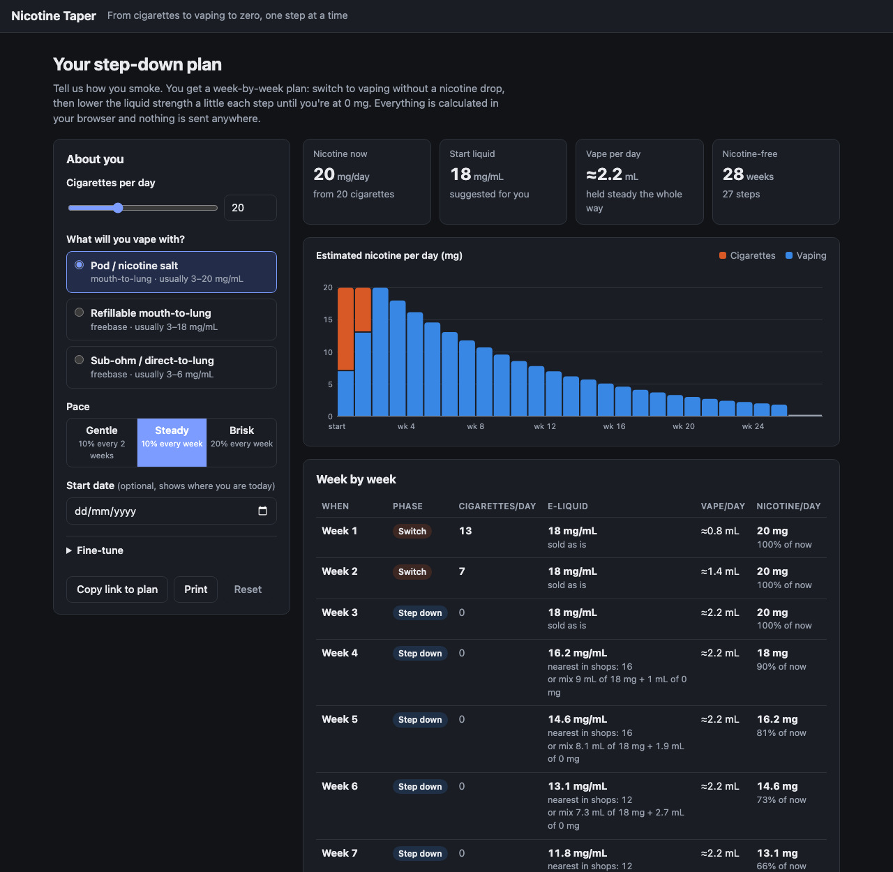

# Nicotine Taper

Quit smoking one step at a time: swap cigarettes for a vape on day one, then buy a weaker e-liquid every few weeks until you're at 0 mg.

**Live:** https://ciggs.knhdixh.com · auto-deploys from `main` via Workers Builds



## How it works

Answer two questions: how many cigarettes a day, and how fast you want to go.

1. **Day 1:** stop cigarettes and vape an e-liquid strong enough to match them, so there's no nicotine drop.
2. **Every few weeks:** switch to the next weaker strength sold in shops: **20 → 16 → 12 → 6 → 3 → 0 mg/mL**.
3. **0 mg:** keep the habit without nicotine until you're ready to stop.

**Puffs:** about 15 vape puffs replace one cigarette, spread over 16 waking hours. A pack a day is about **300 puffs a day, 19 an hour**.
The puff count stays the same at every step, so the nicotine drop comes from the weaker liquid. At 0 mg it becomes a ceiling to cut down from.

| Cigarettes a day | Start with |
|---|---|
| under 10 | 6 mg |
| 10–19 | 12 mg |
| 20–29 (about a pack) | 16 mg |
| 30 or more | 20 mg (nicotine salt) |

| Pace | Weeks per step | A pack a day takes |
|---|---|---|
| Gentle | 4 | 20 weeks |
| Steady | 3 | 15 weeks |
| Fast | 2 | 10 weeks |

It assumes French cigarettes (EU cap: 1 mg nicotine each) and e-liquid strengths sold in France (20 mg/mL legal maximum).

## Features

- A dated step-by-step plan with one plain instruction per step
- "Right now" card: your current strength, puffs per day and per hour, and days until the next switch
- Remembers your answers in the browser; **Copy link** shares an exact plan; print layout
- Everything is calculated in the browser. `GET /api/plan?cigsPerDay=20&pace=steady&startDate=2026-10-13` returns the same plan as JSON

All the logic is in [`public/taper.js`](public/taper.js), shared by the page, the Worker and the tests.

## Limitations

This is a guide, **not medical advice**. People absorb nicotine differently, so the page explains how to adjust: stay on a step longer if cravings are strong, vape less if you feel sick. Talk to a doctor or pharmacist if you're pregnant, have heart disease or take medication.

## Stack

Cloudflare Workers with static assets. Plain JavaScript, no framework and no build step. Tests use `node:test`.

## Run locally

```bash
npm install
npm test
npm run dev        # http://localhost:8787
```

## Deploy your own

Change or remove `routes` and `CANONICAL_HOST` in `wrangler.jsonc` (they point at `ciggs.knhdixh.com`), then:

```bash
npx wrangler login
npm run deploy
```

No secrets or database are needed.
